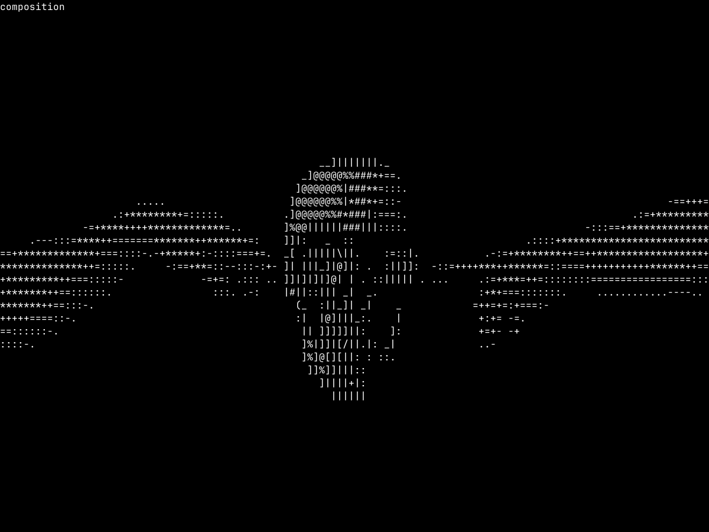

# Две руки и вращающийся череп

Два фрагмента одного PNG привязаны к краям терминала, череп занимает отдельную центральную область. В исходном ракурсе пальцы почти касаются его силуэта. При вращении руки остаются на месте: силуэт черепа меняется относительно фиксированных пальцев. Это композиция со статичным фоном; объёмные руки и физический контакт не рассчитываются.



[Текстовый кадр](composition.txt): 120×40 символов без строки статуса, cell aspect 0.5, viewport модели 50×40, sampling модели 2×4. Шрифт JetBrains Mono Regular v2.304, 16 px/em, ячейка атласа 10×22. PNG-превью использует битмапы fontdue; реальное сглаживание терминала может отличаться.

Исходники примера: локальные `Skull.obj`, объект `part_0`, и `Creation-of-Adam.png` размером 4999×2812. X-поворот модели 180°. Для PNG используются области [0, 2499) и [2499, 4999), исходный файл не меняется. При загрузке альфа смешивается с чёрным, а цвет преобразуется в яркость. Чёрные поля не определяют положение кончиков пальцев. Обе руки имеют одинаковый физический масштаб и отдельные позиции. Перед подбором тональных символов яркость уменьшается усреднением по площади через сетку 2×4.

Параметры: центральная доля ширины 0.42, зазор 1 столбец, яркость рук 0.65. Меняйте `--hands-gap` для расстояния от пальцев до модели, `--center-width` для размера центральной области, `--hands-brightness` для яркости слоя. Модель загружается обычным OBJ-конвейером; фоновый слой не меняет глубину и освещение модели.

```sh
cargo run --release -- Skull.obj --object part_0 --rotate-x 180 \
  --hands Creation-of-Adam.png \
  --font tests/fixtures/fonts/JetBrainsMono-Regular.ttf
```

Параметры, клавиши, пауза и смена размеров работают в обычном просмотрщике. В depth/silhouette/normals видна только модель в той же центральной области. Статичный слой пересчитывается при изменении размеров, пропорций, zoom или видимости строки состояния, а не каждый кадр. `H` скрывает строку и отдаёт сцене всю высоту окна. Для запуска с медленным вращением без статуса добавьте `--rotation-speed 1.5 --hide-status`; `<` и `>` меняют скорость на 0.5°/с, Space сохраняет независимую паузу.

Для воспроизводимого кадра без терминала:

```sh
cargo run --release --example composition -- Skull.obj --object part_0 --rotate-x 180 \
  --hands Creation-of-Adam.png --font tests/fixtures/fonts/JetBrainsMono-Regular.ttf \
  --snapshot-dir target/creation-preview

python3 examples/preview_ascii.py target/creation-preview composition
```

Снимки появятся в `target/creation-preview/composition.txt` и `.png`. `--angle 90` показывает профиль с тем же положением рук. Для 80×24 добавьте `--columns 80 --rows 24`; PNG-генератору также передайте `--columns 80`.

Проверки покрывают нечётную ширину изображения, прозрачную середину, разную яркость и высоту рук, сохранение физических пропорций, наложение тёмной геометрии, малые окна и сохранение истории ASCII. PTY-проверка использует синтетический PNG и проверяет неподвижные края при вращении и смене света/тона, скрытие фона в диагностике, zoom, resize и восстановление терминала. Эти проверки не зависят от локальных художественных исходников.
