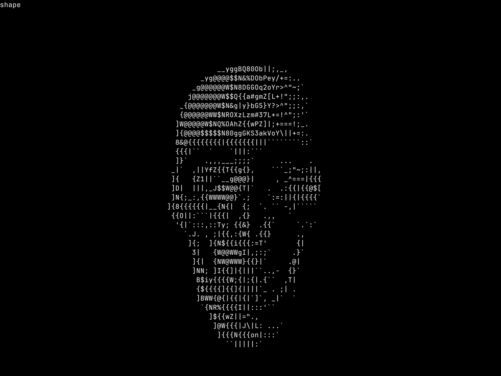
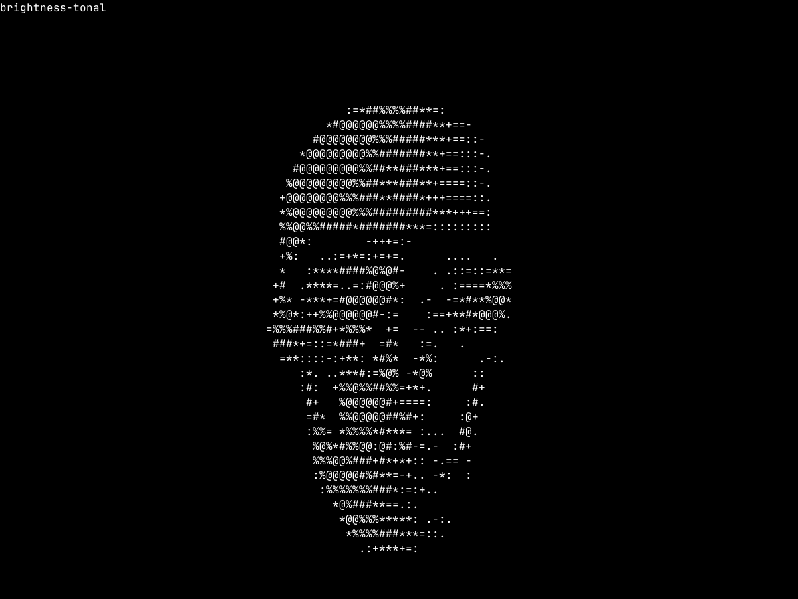
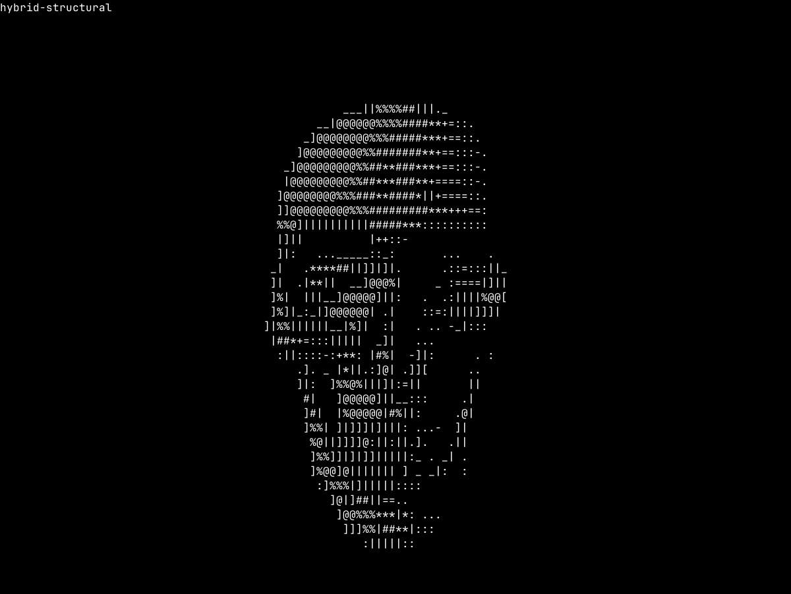

# Палитры, гибридный выбор и удержание символов

Плавные поверхности используют тональные символы; выраженные границы допускают направленные штрихи. Палитра `full` остаётся явным экспериментом: один штраф за сложность не устраняет текстовый шум так же надёжно, как ограничение набора кандидатов.

## Сравнение исходного ракурса

Одинаковые камера, свет, tone mapping и шрифт JetBrains Mono Regular v2.304, 16 px/em, ячейка 10×22. Локальный `Skull.obj`, `part_0`, X=180°, 31 016 треугольников, 120×40 символов, sampling 2×4, cell aspect 0.5, contrast 1.2, gamma 1. Модель остаётся локальной.

- [Прежний shape из полного атласа](font/shape.txt): буквы и цифры смешиваются с поверхностями.
- [Только тональная яркость](font/brightness-tonal.txt): наиболее однородная заливка.
- [Гибрид structural по умолчанию](font/hybrid-structural.txt): тональная масса с дополнительными штрихами у границ.
- [Гибрид с full](font/hybrid-full.txt): расширенные кандидаты доступны у границ.
- [Встроенный гибрид](builtin/hybrid-structural.txt) для запуска без шрифта.

PNG ниже получены из тех же текстовых снимков и экспортированных битмапов fontdue. Они показывают размещение глифов в атласе; сглаживание настоящего терминала может отличаться.

Прежний полный shape:



Тональная яркость:



Гибрид structural:



На своде черепа возвращается последовательная тональная поверхность. Границы глазниц и челюсти получают структурные символы; некоторые участки всё ещё образуют цепочки вертикальных штрихов. Сетка 2×4, отсутствие теней/AO и тёмные внутренние поверхности ограничивают анатомическую читаемость. Подбор не восстанавливает отсутствующие в исходных отсчётах детали.

## Измерения

Локальный Linux, Rust 1.98.0, release. По 300 вращающихся кадров и 300 преобразований неподвижного кадра. Вращение 0.003490659 радиан за кадр соответствует 6°/с при 30 FPS; приложение ограничивает частоту, benchmark работает без ожидания. Первый вращающийся кадр не входит в счётчик смен символов. Экспорт, загрузка OBJ, создание атласа, сбор статистики и терминальный I/O исключены из времени кадра. Результат зависит от нагрузки системы.

| Вариант | Кадр, мс | Растеризация, мс | ASCII при вращении, мс | ASCII неподвижный, мс | Смены символов |
| --- | ---: | ---: | ---: | ---: | ---: |
| brightness | 7.919 | 7.744 | 0.176 | 0.153 | 91152 |
| shape | 8.502 | 7.880 | 0.622 | 0.572 | 37457 |
| brightness-tonal | 8.112 | 7.963 | 0.149 | 0.132 | 20495 |
| hybrid-tonal | 9.233 | 8.000 | 1.233 | 1.110 | 14828 |
| hybrid-structural-unstable | 8.947 | 7.783 | 1.164 | 1.098 | 17847 |
| hybrid-structural | 9.043 | 7.808 | 1.235 | 1.120 | 16194 |
| shape-full-penalized | 8.210 | 7.552 | 0.658 | 0.597 | 37333 |
| hybrid-full | 9.166 | 7.816 | 1.350 | 1.243 | 18997 |

Однократное создание шрифтового атласа: 7.218 мс. Для structural удержание снизило число смен с 17 847 до 16 194 — примерно на 9.3%. Это мера стабильности символов, а не самостоятельная оценка качества картинки. История не усредняет яркость и геометрию; тесты проверяют немедленную очистку фона и отказ от удержания при заметном изменении покрытия, глубины или нормалей.

На тональных участках гистерезис сравнивает ошибки плотности; сравнение рисунка штрихов здесь могло бы чрезмерно задерживать переход между ступенями яркости. У границ используется ошибка маски со штрафом. Для проверки без истории задайте `--stability 0`; для чистого сравнения масок — также `--complexity-penalty 0`.

Полные журналы: [шрифтовой](font/benchmark.txt), [встроенный](builtin/benchmark.txt). Остальные снимки имеют те же имена, что и варианты в журнале. Диагностические снимки силуэта используют tonal/brightness независимо от выбранного алгоритма.

## Воспроизведение

```sh
cargo run --release --example benchmark -- Skull.obj --object part_0 --rotate-x 180 \
  --compare-glyphs --snapshot-dir docs/palettes/builtin

cargo run --release --example benchmark -- Skull.obj --object part_0 --rotate-x 180 \
  --compare-glyphs --font tests/fixtures/fonts/JetBrainsMono-Regular.ttf \
  --font-size 16 --snapshot-dir docs/palettes/font

python3 examples/preview_ascii.py docs/palettes/font shape brightness-tonal hybrid-structural
```

Экспорт атласа: [PGM](font/atlas.pgm), [метаданные](font/atlas-info.txt), [плотности и маски](font/densities.tsv). PNG-генератор использует только стандартную библиотеку Python и экспортированные битмапы, без повторной растеризации шрифта.
